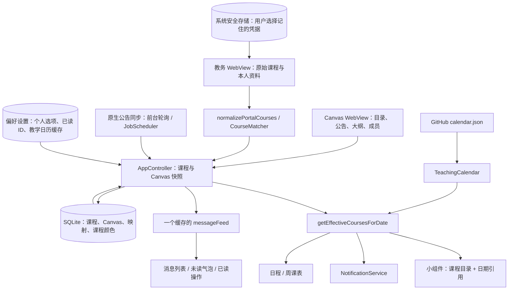

> 本文是上一版 1.14.23+76 精简结构测试版的审查快照。本轮 1.14.23.1+77 的新增接口、文件变化与构建结果见 apk-packaging.md 和 delivery-verification.md；此前结构精简记录继续保留。
# 1.14.23 精简测试版：功能接口与结构审查

审查日期：2026-10-03。基线：正式 1.14.23 / versionCode 75，Git `1d72b8a`。测试包：versionName `1.14.23` / versionCode `76`，应用名「交大课表·精简测试」，包名 `cn.sjtu.jiaotong_course.slimtest`。本报告依据当前源码、调用方和测试结果；用户附带的 B 站搜索页和图片无法读取，未将其内容作为证据。

## 1. 实际目标与结构原则

应用的主要任务是：导入原始课程；根据教学日历得到实际日期的课程；展示课程与 Canvas 内容；生成提醒与小组件；管理用户选择的设置。界面直接读取应用状态，网络与 Android 能力各有一个实际实现。无需为这些任务再增加 UseCase、通用 Repository、DTO 转换或控制器转发层。

「一个功能只有一个实现」按实际业务行为判断：一个网站只有一套地址、登录参数和打开方法；实际当天课程只有一个计算器；消息只有一个合并/去重结果；缓存只在一个主要存储里保存。网站首页与完整列表、浅色与深色、通知与闹钟是已存在且用途不同的用户功能，不是可以随意删掉的重复实现。

保留登录重定向判定、异步任务失效检查、下载校验、离线教学日历缓存和头像加载失败处理。这些有已知问题或明确功能要求作为依据。本次删除重复写入、无调用方的旧入口和临时样式比较功能，没有增加新的备用实现。

## 2. 当前数据流



原始课程不因节假日、调休或考试周标识而永久修改。Flutter 是教学日历的唯一解释者；原生小组件只渲染 Flutter 已计算的日期结果。

## 3. 功能入口 → 实际实现

| 功能 | 入口与调用接口 | 唯一业务实现 / 状态归属 |
|---|---|---|
| 启动和恢复 | `main → AppController.bootstrap` | SQLite 恢复业务快照；偏好设置恢复选项；`SecureCredentialStore` 恢复记住的凭据 |
| jAccount 登录、验证码 | `LoginPage → PortalSyncPage` | `SchoolWebAuthenticator.inspect / fill / submit`；验证码由用户完成；不增加另一套登录客户端 |
| 教务课表导入 | `PortalSyncPage → portalCaptureBootstrapScript / portalExtractorScript` | 同一教务 WebView 内捕获接口数据和页面内容 → `Course.fromMap` → `normalizePortalCourses` |
| 本人学号、姓名、学院 | `portalStudentProfileRequestScript → saveStudentProfileForSession` | 经过当前账号与会话代次校验后写入状态和本人资料缓存 |
| 提交同步结果 | `AppController.saveSyncedData` | 单一同步提交入口，`CourseMatcher.apply` 绑定 Canvas 课程；SQLite 事务保存快照 |
| Canvas 首次及完整同步 | `HomeShell → initializeCanvasAfterLogin / refreshNow` | `SessionSyncAgent._refresh` 是 `SyncLoader` 的唯一运行实现；提取脚本 → `CanvasSyncAccumulator` → `applyCanvasCatalog / saveSyncedData` |
| Canvas 公告自动同步 | `CanvasAnnouncementObserver → CanvasAnnouncementSync` | 原生 `CanvasAnnouncementSync.kt` 获取公告；Dart `merge` 合并快照；`applyAnnouncementUpdates` 仅持久化 Canvas |
| 公告汇总、去重、顺序 | `AppController.messageFeed` | `buildAnnouncementFeed` 负责来源绑定、去重和一次排序；`buildMessageFeed` 生成稳定已读键，不再二次排序 |
| 未读计数与已读 | `unreadMessageCount / markMessageRead / markCanvasItemRead / markAllMessagesRead` | 共享 `messageFeed`；已读 ID 按账号存储在偏好设置，内容不写入已读键 |
| 日程今日课程、正在上课、下一节课 | `HomePage → getEffectiveCoursesForDate` | `TeachingCalendar.getEffectiveCoursesForDate`；页面仅根据计算结果和课程时间展示 |
| 周课表、切周、今天高亮 | `WeekPage → effectiveCoursesForWeek / selectWeek` | 每个真实日期调用同一课程计算；`weekdayInDisplayedWeek` 只标记本周今天 |
| 教学日历下载、解析、缓存 | `startTeachingCalendarSync / refreshTeachingCalendar` | `TeachingCalendarRepository` 唯一远程读取实现；`TeachingCalendar.parse` 校验；有效缓存先读、后台更新 |
| 自动学期、周次、考试周 | `currentSemester / termStart / totalWeeks / currentAcademicWeekInTerm / examWeeks` | `TeachingCalendar.semesterFor / weekForDate`；JSON 学期为 null 时保持原有未公布学期行为 |
| 调休与考试周横幅 | `HomePage` 底部横幅 | `TeachingDateRule.makeupMessage` + 当前实际教学周的 `examWeeks`；不修改课程逻辑 |
| 课程详情与手动 Canvas 绑定 | `CourseDetailPage → canvasCourseFor / mapCourseToCanvas` | `CanvasSnapshot.courseById`，同一匹配器与同一课程映射表 |
| Canvas 公告、大纲阅读 | `CanvasHtmlPage / CanvasHtmlView` | 同一 HTML 阅读组件；网络课程页面仍使用 `AuthenticatedWebPage` |
| 成员头像 | `_CanvasPersonAvatar → CanvasAvatarCache.read / download` | Canvas 头像 URL → 同一 Cookie 请求头提供器 → 每 URL 合并请求、本地图片缓存；失败稳定回退默认头像 |
| 常用网站首页及更多 | `CommonWebsiteGrid / 完整列表 → SettingsPage._openWebsite` | `commonWebsites` 唯一配置表 + `AuthenticatedWebPage`；九个网站地址、顺序、认证参数保持一致 |
| WebView 左右滑、工具栏、系统返回 | `AuthenticatedWebPage` 共用返回处理器 | `WebHistoryPolicy` 选有效历史；`WebNavigationGuard` 阻止旧回调；`AndroidWebHistory.stopAndSnapshot / goBackTo` |
| WebView 直接关闭 | `× → AndroidWebHistory.stopLoading → Navigator.pop` | 不执行网页返回，不删除 Cookie |
| 图书馆、研究生平台导航判定 | `LibraryNavigation / GraduateNavigation` | 站点导航规则，由同一 `AuthenticatedWebPage` 调用，不另建浏览器实现 |
| 地图定位 | `LocationPermissionService.request` | 原生权限通道 `requestLocationPermission`，只在地图请求定位时使用 |
| 主题与深浅模式 | `setThemeChoice / setInterfaceMode` | `AppThemeChoice`、`InterfaceMode` 与根组件的同一主题构造方法；日常业务通知不再重建主题 |
| 上课通知与闹钟 | `setReminderMode / setReminderMinutes / restoreReminders` | `NotificationService` + `flutter_local_notifications`；同一实际课程结果，通知/闹钟仅通知参数不同 |
| 小组件跨天、启动、恢复、点击课程 | `TimetableWidgetBridge → TimetableWidgetProvider` | Flutter 预计算；Android RemoteViews 渲染目录引用；显式点击 Intent 回传原始课程 ID |
| 检查更新 | `UpdateObserver / UpdateSettingsEntry → UpdateManager.check` | `GitHubReleaseApi.latest`；正式版本逐段比较；稍后再说的 24 小时限制保持 |
| APK 下载、安装、未知来源授权 | `UpdateManager → AndroidUpdateBridge → AppUpdateBridge` | Android DownloadManager + FileProvider + 系统安装界面；继续检查包名、签名、完整性和授权 |
| 退出登录 | `AppController.logout` | 当前会话失效、取消提醒、清理本人状态与 SQLite、凭据和 WebView 会话；保持原有退出行为 |

完整源文件和公开接口清单见同目录 `interface-inventory.md`。纯 UI 子组件的 `build` 不算第二套业务实现。

### 运行时接口与实现对应关系

| 接口 | APK 中的实际实现 | 测试替身 |
|---|---|---|
| `CredentialStore` | `SecureCredentialStore` | 单元测试的内存凭据存储 |
| `ReleaseRepository` | `GitHubReleaseApi` | 模拟 Release 结果与错误 |
| `UpdatePlatform` | `AndroidUpdateBridge` | 模拟下载/授权/安装结果 |
| `SyncLoader` | `SessionSyncAgent._refresh` | 测试中构造确定的同步结果 |
| `AppDatabase` | SQLite 数据库 | `test/support/memory_database.dart`，只存在于测试目录，不打入 APK |

没有增加通用仓储、依赖注入框架、转发型服务或多套运行实现。

## 4. 外部网络接口

| 来源 | 接口 / 入口 | 使用位置与认证 |
|---|---|---|
| 教务系统 | `https://yjsxk.sjtu.edu.cn/yjsxkapp/sys/xsxkapp/index.html` | `PortalSyncPage`，沿用 WebView jAccount Cookie |
| 教务系统本人资料 | `/yjsxkapp/sys/wdpyjhapp/modules/wdpyjh/wdxx.do` | 原教务 WebView 内 GET，`credentials: same-origin` |
| 教务课程响应 | 当前教务页面实际发出的课表 JSON 与 DOM | 捕获已有响应，不增加模拟教务 HTTP 登录或猜测新接口 |
| Canvas SSO | `https://oc.sjtu.edu.cn/login/openid_connect` | 原有登录跳转与 Cookie |
| Canvas 课程 | `/api/v1/courses` | `canvas_extractor.dart`，WebView 登录上下文、分页 |
| Canvas 控制台动态 | `/api/v1/users/self/activity_stream` | 同一 Canvas 登录上下文、分页 |
| Canvas 公告 | `/api/v1/courses/{id}/discussion_topics?only_announcements=true` 与 `/api/v1/announcements?context_codes[]=course_{id}` | 现有 Canvas 提取/批量后台公告同步。两种接口有现有权限差异与批量用途，本轮未改变协议选择 |
| Canvas 成员 | `/api/v1/courses/{id}/users` | 原有成员提取，保留教师→助教→学生及同角色顺序 |
| Canvas 头像 | API 返回的头像 URL | 原有 `canvas_avatar.dart` URL 规范化与 Cookie 请求头，`CanvasAvatarCache` 负责图片 |
| 教学日历 | `https://raw.githubusercontent.com/revanbastila/sjtu-calendar-data/main/calendar.json` | `TeachingCalendarRepository`，HTTPS，无 Token，校验后更新有效缓存 |
| GitHub 正式更新 | `https://api.github.com/repos/revanbastila/SJTU-Timetable/releases/latest` | `GitHubReleaseApi`，无 Token，拒绝 Draft/Pre-release |
| APK | 对应 Release 的 `browser_download_url` | `AppUpdateBridge`，GitHub 合法 HTTPS 来源、系统下载与安装 |

九个常用网站 URL 集中在 `lib/models/common_website.dart`。Cookie 不经过功能文档或日志输出。

## 5. Flutter ↔ Android 通道契约

所有通道都绑定当前 Flutter 引擎；测试包虽沿用通道名，但与正式包属于不同进程和数据目录。

| 通道后缀（前缀 `cn.sjtu.jiaotong_course/`） | 方法 | 一侧接口 / 原生实现 |
|---|---|---|
| `web_history` | `stopLoading`、`stopAndSnapshot`、`goBackTo` | `AndroidWebHistory` / `MainActivity` 的 WebView 历史处理 |
| `web_history` | `canvasCookies` | 头像请求头 / `MainActivity`，限制 Canvas HTTPS 主机 |
| `widget` | `updateSnapshot`、`consumePendingCourseId` | `TimetableWidgetBridge` / `MainActivity` + `TimetableWidgetProvider` |
| `widget`（原生回调） | `openCourse` | 原生点击 → Flutter `CourseDetailPage` |
| `announcements` | `configure`、`cached`、`refresh` | Dart `CanvasAnnouncementSync` / Kotlin `CanvasAnnouncementSync` |
| `permissions` | `requestLocationPermission` | `LocationPermissionService` / `MainActivity` |
| `updates` | `version`、`state`、`download`、`install`、`allowInstall`、`openRelease` | `AndroidUpdateBridge` / `AppUpdateBridge` |

### 小组件协议 schema 3

```json
{
  "schema": 3,
  "calendarVersion": "远程规则版本",
  "termLabel": "当前学期名称",
  "hasTimetable": true,
  "courses": [{"id":"原始课程 ID","name":"名称","teacher":"教师","location":"地点","startHour":8,"startMinute":0,"endHour":9,"endMinute":40,"widgetColor":0}],
  "effectiveDays": {
    "YYYY-MM-DD": {"academicWeek":3,"courseRefs":[0],"emptyMessage":null}
  }
}
```

`courseRefs` 是目录下标，保留当天已经计算好的顺序。目录键包括课程 ID、课程身份、名称、教师、地点与起止时间；不会只凭课程 ID 混合不同会次。调休课程仍引用原课程资料。原生端不再从 weekday/activeWeeks 另算一次，也不再解析旧快照格式。独立测试包首次生成 schema 3；正式版原有快照不受影响。

## 6. 本次明确删除或收敛的内容

| 原问题 | 精简后的处理 |
|---|---|
| AppScope 没有调用方，根 AnimatedBuilder 监听所有业务变化 | 删除 AppScope；根组件只响应主题、界面模式、登录状态这三个实际依赖 |
| 列表、气泡、已读操作各自重新合并消息；消息二次排序 | 使用同一个 `AppController.messageFeed`；快照或课程映射变化才失效；只排序一次 |
| 每读一个课程颜色就重新扫描全部课程；唯一课程用 List.contains | 已分配颜色直接查 Map；生成时用保序 Set 去重 |
| 每个状态事件重新计算、编码整个学期的小组件快照 | 根据课程、日历、学期参数和课程颜色判断是否重算；发送失败仍能重发已计算结果 |
| 每一天重复传输课程名称、教师、地点与颜色 | 一份目录 + 日期索引；删除原生重复周次/weekday/activeWeeks 计算、重复排序和未使用的协议字段 |
| 九个网站重复创建相同路由，格子读取 ListTile 子节点反推数据 | 一个 CommonWebsite 配置表、一个打开方法；格子直接读配置 |
| 常用网站保留隐藏的黑色/主题色比较开关 | 删除临时开关，仅保留当前默认 `onSurface` 文字样式；系统深浅模式继续适配 |
| `saveStudentNumberForSession`、`login` 只是旧转发，`coursesForWeek` 绕开实际日历，`setTerm` 已无 UI 调用方 | 删除无实际调用方的旧接口与手动学期调度定时器；本人资料和同步分别只保留现用入口 |
| `Course.demo()` 始终返回空列表 | 删除无意义的 demo 分支，直接保存实际导入结果 |
| Android `goBackOrForward` 方法通道没有实际业务调用方 | 删除额外入口；保留已有 `goBackTo` 返回路径及其原生跳过历史实现 |
| 公告服务留有整段注释掉的旧去重实现 | 删除不可执行的旧代码 |
| SQLite 与偏好设置双写整个课表/Canvas/颜色 | SQLite 唯一业务缓存；偏好设置只存选项、本人资料、已读标识和日历缓存。旧快照仅迁移一次，提交成功后移除旧副本 |
| 公告更新重写课程、映射、个人选项 | `AppDatabase.saveCanvas` 仅更新 Canvas 记录；同步全量数据时用同一 SQL 事务保存课程、Canvas、颜色与映射 |
| SQL 不可用仍默默报告保存成功 | SQL 写操作明确失败，不启用第二种业务快照存储；首次旧数据迁移失败时保留输入并记录错误 |

## 7. 性能与验证

同一测试脚本 `test/hot_path_benchmark_test.dart` 分别针对未修改的正式源码和精简源码运行。样本为 20 门课程、每课 3 条公告、18 教学周；先完成一次消息/颜色初始化，再重复读取。指标是确定的工作次数与传输字节，不等同于手机帧率或耗电百分比。

| 检查 | 正式基线 | 精简测试版 |
|---|---:|---:|
| 300 次消息读取，原始课程列表访问 | 6000 | 0 |
| 300 次颜色读取，原始课程列表访问 | 6000 | 0 |
| 20 次内容未变的小组件检查，日期课程计算 | 2521 | 127 |
| 同一小组件快照 UTF-8 大小 | 95,000 B | 12,619 B |
| 5 次选周，MaterialApp 根节点重建 | 5 | 0 |
| 20 次内容未变的小组件检查，原生发送 | 1 | 1 |

已验证的行为包括：消息缓存遇新公告/课程映射/退出登录正确失效；已读状态保留；小组件发送失败可重发且不会重算；颜色、教师、节假日变化正确生成新快照；九个网站点击的 URL 与全部认证参数不变；主题和登录状态仍能更新根节点；单一 SQL 存储、一次迁移与公告局部保存。

旧横幅测试在正式基线中也会失败：scrollUntilVisible 只保证文字顶部进入视口，而测试要求整段文字底部也在横幅上方。本次改为完整 ensureVisible 后断言，没有改动横幅布局。

当前静态检查及最终测试、编译、签名结果记录在 `delivery-verification.md`。校园账号联网登录、MuMu/手机视觉与系统提醒实测未包含在本轮自动化结果中。

## 8. 有依据地保留的边界

AppController 仍是应用状态唯一所有者。虽然文件较大，本次没有把每个方法机械拆成新层。各页面仍监听业务状态，根节点的无关重建已去掉；若真实设备仍有卡顿，应根据具体重建或同步记录再拆分订阅范围。

完整 Canvas 同步获取课程、大纲和成员；公告轮询只获取公告，前台约 2 分钟，后台 JobScheduler 约 15 分钟且受 Android 调度约束。它们是不同负载与生命周期，不把轻量轮询改成反复全量同步。公告去重首轮仍有内容等价比较，后续消息读取复用结果，本次没有猜测新身份规则来替换既有去重语义。

WebView 的站点特征判定、登录 Cookie、回调失效标识都有之前实际故障的依据。没有将其压缩成失去历史跳过能力的普通 goBack，也没有通过删除异常隔离让后台服务错误中断主界面。

## 9. 测试包使用与回退

独立源码目录：`outputs/SJTU-Timetable-1.14.23-slim-test/`。APK：`outputs/jiaotong_course-1.14.23-slim-test.apk`。正式源码目录仍为 `outputs/jiaotong_course_app/`，正式 APK `jiaotong_course-1.14.23.apk`。

测试包的包名、缓存、登录状态与正式包独立，需要在测试包重新登录。可同时安装；回退时直接打开正式包，无需覆盖降级或迁移测试数据。测试包使用 E 盘现有 Android 测试 keystore，Gradle 中没有正式密钥读取配置，也不带 `key.properties`。

本轮没有上传 GitHub。测试包保留更新检查网络逻辑，但正式仓库 APK 的包名/签名与测试包不同，不能作为这个测试包的覆盖升级；不应为此放宽安装校验。

重新构建：在测试源码根目录执行 `./scripts/build_apk.ps1 -Offline`。脚本把产物命名为 `jiaotong_course-1.14.23-slim-test.apk`，不会覆盖正式 APK；运行目录、工具、缓存与日志均在指定 E 盘工作区。

